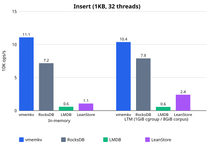
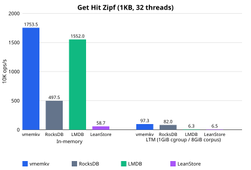
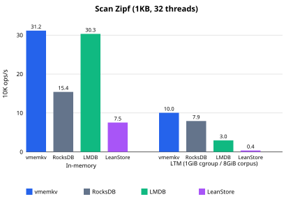
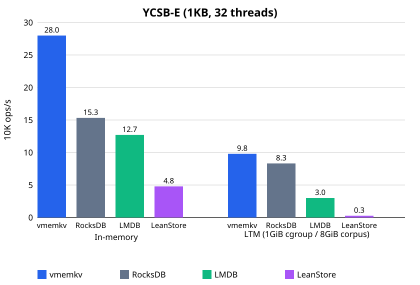

# vmemkv

vmemkv is a larger-than-memory key-value store that delegates I/O management to the OS virtual-memory subsystem (`mmap` / `fork` / `mincore`), keeping the implementation simple while delivering production-grade performance.

## Features

- Larger-than-memory data operation on file-backed `mmap`
- Get / Insert / Update / Delete / Scan KVS API
- Durability via WAL and checkpoint
- Out of scope (by design): multi-operation transactions, phantom avoidance

## Performance

Throughput in units of 10K operations/s (32 threads, 1 KB values with 20% 8 B mix).
Values are medians from `benchmark/results/10_23.json`; vmemkv uses its production
configuration (+Inline). Scan Zipf uses the default non-shuffled scan. Exact figures
are in the details table below.

Rival configurations (all durable per write, like vmemkv):
- RocksDB: WAL fsync per write (`sync=true`), no compression.
- LMDB: `MDB_WRITEMAP` without `MAPASYNC`, so every commit synchronously msyncs.
- LeanStore: WAL on with per-group fdatasync; every mutation waits for a covering group flush.

|  |  |
| --- | --- |
|  |  |

<details>
<summary>Exact figures (10K ops/s)</summary>

In-memory:

| Workload     | vmemkv | RocksDB | LMDB   | LeanStore |
| ------------ | -----: | ------: | -----: | --------: |
| Insert       |   11.1 |     7.2 |    0.6 |       1.1 |
| Get Hit Zipf | 1753.5 |   497.5 | 1552.0 |      58.7 |
| Scan Zipf    |   31.2 |    15.4 |   30.3 |       7.5 |
| YCSB-E       |   28.0 |    15.3 |   12.7 |       4.8 |

Larger-than-memory:

| Workload     | vmemkv | RocksDB | LMDB  | LeanStore |
| ------------ | -----: | ------: | ----: | --------: |
| Insert       |   10.4 |     7.9 |   0.6 |       2.4 |
| Get Hit Zipf |   97.3 |    82.0 |   6.3 |       6.5 |
| Scan Zipf    |   10.0 |     7.9 |   3.0 |       0.4 |
| YCSB-E       |    9.8 |     8.3 |   3.0 |       0.3 |

Get Hit Zipf scaling, in-memory (10K ops/s):

| Threads | vmemkv | RocksDB | LMDB   | LeanStore |
| ------- | -----: | ------: | -----: | --------: |
| 1       |   63.3 |    27.9 |   61.6 |       5.5 |
| 4       |  260.2 |   101.3 |  244.6 |      22.4 |
| 16      | 1064.4 |   379.9 |  962.7 |      55.3 |
| 32      | 1753.5 |   497.5 | 1552.0 |      58.7 |

</details>

Archived benchmark data: [`benchmark/results/10_23.json`](benchmark/results/10_23.json) contains the 2026-10-23 matrix; [`benchmark/results/ycsb_e.json`](benchmark/results/ycsb_e.json) contains the YCSB-E LTM results and timelines.

### Why it's fast

- In-place updates (like [FASTER](https://doi.org/10.1145/3183713.3196898)): no version stacking; base-region discipline keeps direct reads safe ([low_level_design.md](docs/specification/low_level_design.md) 3.3).
- Key-value separation (like [WiscKey](https://doi.org/10.1145/3033273)): keys live in the Tier 1 index, values in the Tier 2 log.
- 8-byte inline covering: small values live in the Tier 1 payload, so `Get()` completes without touching Tier 2 (7.2).
- OS-delegated paging with explicit readahead control: no buffer pool or page replacement of its own; four mappings (quadfecta) chosen per record size and reader (7.4, 7.5).
- Where rivals win: LTM Get is close to RocksDB (97.3 vs 82.0), and LMDB trails closely on in-memory Get (1552.0 vs 1753.5) — both visible above.

## Usage

```cpp
#include <vmemkv/vmemkv.hpp>
#include <span>

vmemkv::VMemKVStore store("/tmp/mydb.bin", 1ULL << 30);  // Tier 2 file + capacity
store.insert("hello", "world");                          // false if key exists
store.update("hello", "new");                            // false if key absent
store.get("hello", [](std::span<const std::byte> value) { /* use value inside callback */ });
store.scan("a", "z", [](std::span<const std::byte> key, std::span<const std::byte> value) { /* in order */ });
store.remove("hello");                                   // false if key absent
store.bulk_load(n, make_key, make_value);                // fast initial load, no WAL, single-threaded only
store.reorganize();                                      // T1-only merge, no I/O
store.checkpoint();                                      // durable checkpoint, compacts WAL into manifest
auto stats = store.get_statistics();                     // VMemKVStatistics counters
```

A buildable minimal program lives in [`example/`](example/).

## Platform & Guarantees

| Item         | Guarantee                                                        |
| ------------ | ---------------------------------------------------------------- |
| Platform     | Linux (`mmap` / `fork` / `mincore` based; macOS/Windows unsupported) |
| Thread safety| `VMemKVStore` methods are safe to call concurrently (see the concurrency matrix in `src/vmemkv/vmemkv_impl.hpp`) |
| Durability   | Every successful `insert` / `update` / `remove` is WAL-durable via group commit; `checkpoint()` compacts it into a manifest |
| Transactions | Single-operation only (multi-operation transactions out of scope by design) |

## Build, Test, Benchmark

### Prerequisites

| Tool            | Version                                                            |
| --------------- | ------------------------------------------------------------------ |
| CMake           | 3.16 or later                                                      |
| C++ compiler    | C++23 capable (GCC 12 / Clang 16 or later)                         |
| RocksDB (opt.)  | `brew install rocksdb` / `apt install librocksdb-dev` (`-DENABLE_ROCKSDB=ON`) |
| LMDB (opt.)     | `brew install lmdb` / `apt install liblmdb-dev` (`-DENABLE_LMDB=ON`) |
| LeanStore (opt.)| `apt install libtbb-dev libaio-dev` (`-DENABLE_LEANSTORE=ON`; backend fetched automatically) |

Rival backends are comparison harnesses for tests/benchmarks and default to `OFF`.
CI enables all three explicitly.

### Build

```bash
# Configure from the repository root
cmake -S . -B build -DCMAKE_BUILD_TYPE=Release

# With rival comparison backends (all optional, default OFF)
cmake -S . -B build -DCMAKE_BUILD_TYPE=Release -DENABLE_ROCKSDB=ON -DENABLE_LMDB=ON -DENABLE_LEANSTORE=ON

# Build all targets
cmake --build build --parallel
```

### Test

```bash
# After building
ctest --test-dir build --output-on-failure
```

Or run directly:

```bash
./build/tests/test_kv_store   # correctness checks across all variants
```

### clang-tidy (static analysis)

```bash
# Run from the repository root
cmake -S . -B build-clang \
	-DCMAKE_CXX_COMPILER=clang++ \
	-DCMAKE_BUILD_TYPE=Release \
	-DCMAKE_WARN_DEPRECATED=OFF \
	-DENABLE_ROCKSDB=ON

cmake --build build-clang --target clang-tidy-check
```

The current `.clang-tidy` stays close to defaults without extra `CheckOptions`.
Overly strict spots from doctest macros (e.g. `readability-function-cognitive-complexity`)
are absorbed locally in test code with `NOLINTNEXTLINE(...)`.

### Benchmark

`ENABLE_BENCHMARK` defaults to `ON`; pass `-DENABLE_BENCHMARK=OFF` to skip the benchmark targets.

```bash
# Build the microbenchmark binary
cmake -S . -B build -DENABLE_BENCHMARK=ON
cmake --build build --target bench_kv

# Run directly (raw Google Benchmark JSON)
./build/benchmark/bench_kv --benchmark_filter='^Store=VMemKV/' --benchmark_min_time=5.0s
```

Measurement protocol: no warmup discard (each cell measures one continuous window
after corpus pre-population on the same host); Get/Update/Scan cells run at least
5 seconds, Insert/Delete run 5-second wall-clock loops, YCSB-E runs 30 seconds.
Each cell runs 3 repetitions and the median is reported. WAL and
data share one device for every backend.

The matrix runner and AWS Spot reproduction requirements are documented in [`benchmark/README.md`](benchmark/README.md).

## License

MIT License. See [LICENSE](LICENSE).
