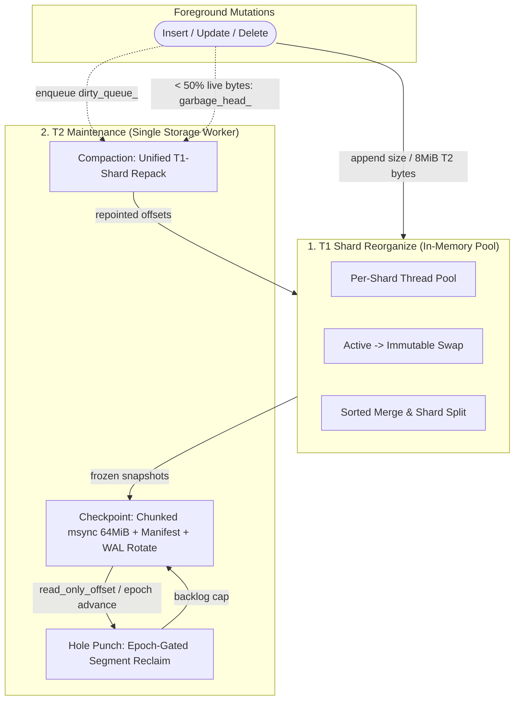

# vmemkv Background Maintenance Architecture

## 1. Overview & Guarantees

vmemkv delegates cache replacement and paging to the OS virtual-memory subsystem, and splits internal background maintenance cleanly along the memory/storage boundary into **two independent subsystems**:

1. **Tier-1 Shard Reorganize (In-Memory)**: Eliminates ordering fragmentation within T1 index shards and splits oversized shards with zero disk I/O.
2. **Tier-2 Maintenance (Storage I/O)**: Single dedicated worker coordinating durable checkpoints (bounds WAL replay and freezes T2 base data), unified shard repacking (4KiB page locality + sparse segment evacuation), and epoch-gated hole punching.



### Responsibility and Guarantee Summary

| Subsystem | Primary Guarantee | Execution Model | Trigger Mechanism |
|---|---|---|---|
| **T1 Shard Reorganize** | Preserves $O(\log N)$ binary search latency, L2 cache locality, and $\le 8\,\text{MiB}$ T2 bytes per shard. | Per-shard worker thread pool (`workers_`, isolated per shard, zero I/O). | Shard `memtable_size()` reaches soft threshold ($50\%$ of MemTable capacity, i.e., $16384$ entries), tombstone threshold, or `approx_t2_bytes` $\ge 8\,\text{MiB}$. |
| **T2 Maintenance** | Bounds WAL replay ($\le 64\,\text{MiB}$), freezes T2 Immutable Region (`read_only_offset`), restores 4KiB scan locality, and reclaims sparse 8MiB segments. | Single dedicated background worker (`t2_worker_`). | **Checkpoint**: WAL $\ge 64\,\text{MiB}$ or punch backlog $\ge 1058$ segs (10ms poll).<br>**Compaction & Punch**: `dirty_queue_`, `garbage_head_`, or `punch_head_` (1s idle cadence; continuous while garbage segments remain). |

---

## 2. Tier-1 Shard Reorganize

### 2.1 Purpose & Guarantees
Tier-1 range shards receive new inserts into an unsorted `Active MemTable` (`memtable_active_`). Unchecked growth inflates lookup and scan costs from $O(1) + O(\log N)$ toward $O(N_{\text{memtable}})$. T1 Reorganize guarantees:
- Bounded MemTable size: Restores pure $O(\log N)$ sorted lookup performance.
- Tombstone reclamation: Purges deleted entries without leaving lingering memory overhead.
- Autonomous shard splitting: Halves oversized shards when merged entries exceed either the entry-count threshold or one T2 segment (`kSegmentBytes` = $8\,\text{MiB}$) of referenced T2 payload bytes.

### 2.2 Mechanism & Components
- **Generation Switching**: The `Active MemTable` rotates to `Immutable MemTable` under an atomic pointer swap, allowing concurrent writes to continue immediately into a fresh MemTable buffer.
- **Merge & Shard Split**: The worker merges the `Immutable MemTable` with the existing `Sorted Run` into a new contiguous array. If the resulting entry count or referenced T2 byte sum exceeds the split threshold, the shard splits into two key-partitioned child shards.
- **FreezableRegion (Lost-Update Protection)**: While a merge runs, in-place updates to keys present in the snapshot bypass the old array and append to the fresh `Active MemTable`, preventing concurrent mutations from being overwritten by the merge output.
- **Epoch Drain**: Old sorted and MemTable buffers are deallocated only after all in-flight readers exit via the store-wide `EpochDomain` (`ThreadReferenceTracker`).

---

## 3. Checkpoint Coordinator

### 3.1 Purpose & Guarantees
Tier-2 storage operates over a `MAP_SHARED` sparse flat file. Mutations land directly in the Linux page cache. Checkpoint guarantees:
- Durability: Flushes uncommitted page cache writes in `[old_read_only_offset, target)` to physical storage.
- Startup Bounding: Replays at most $64\,\text{MiB}$ of WAL logs on reboot.
- Immutable-Region Invariance: Advances `read_only_offset` (FASTER `ReadOnlyOffset`), rendering flushed T2 segments permanently immutable and enabling seqlock-free, direct zero-copy reads.

### 3.2 Mechanism & Components
- **Chunked Synchronization**: Synchronizes dirty log ranges using `msync(MS_SYNC)` in chunks of $64\,\text{MiB}$ (`kMsyncChunkBytes`), cooperatively calling `std::this_thread::yield()` between chunks to prevent kernel I/O queue monopolization.
- **Atomic `MANIFEST` Publication**: Writes `<t2>.t1chk/chunk_*.chk` (`VLK2` files) and atomically replaces `<t2>.manifest` via filesystem `rename()`.
- **WAL Log Rotation**: Truncates and advances active WAL log segments past the checkpointed LSN, recycling disk space.
- **Trigger Condition**:
  $$\text{Checkpoint\_Trigger} = \text{WAL} \ge 64\,\text{MiB} \lor \text{Backlog} \ge 1058 \lor \text{Force}$$

---

## 4. Tier-2 Compaction & Unified Shard Repack

### 4.1 Purpose & Guarantees
Out-of-place updates, random inserts, and deletions leave unreferenced records and physical page disorder in Tier 2. Compaction unifies both repairs into a single mechanism—repacking an entire T1 shard in key order—guaranteeing:
- **4KiB Page Locality for Range Scans**: Every T1 shard's live records are written contiguously in full-key order, ensuring adjacent keys share 4KiB OS pages or occupy immediately consecutive forward pages (`are_t2_payloads_page_local`).
- **Physical Space Reclamation**: Sparse frozen segments ($< 50\%$ live bytes) are evacuated by repacking the T1 shards that reference them, dropping the segments' live bytes to zero so they can be hole-punched.
- **$O(1)$ Write-Path Overhead**: Neither segment scans nor shard directory scans occur when queueing work.

### 4.2 $O(1)$ Work Queues
1. **Dirty Shard Queue (`dirty_queue_` / `t2_dirty`)**:
   - The first T2 offset write to a clean shard CAS-transitions `slot->t2_dirty` from `false` to `true` and pushes the shard onto `dirty_queue_`. Subsequent writes to the same shard see `t2_dirty == true` via a single relaxed load and return immediately.
2. **Garbage Segment Queue (`garbage_head_` / `dirty_flag_`)**:
   - `T2Ownership::subtract_segment()` tracks live bytes per $8\,\text{MiB}$ segment. Only when a segment's live bytes drop below $50\%$ (`(previous - hint) * 2 < kSegmentBytes`) does `mark_segment_dirty()` push the segment onto the lock-free `garbage_head_` Treiber stack.

### 4.3 Unified Execution Model (`repack_dirty_shard` & `t2_maintenance_loop`)
A single dedicated storage worker (`t2_worker_`) runs `t2_maintenance_loop()` via `poll_worker_until_stop()` at a $10\,\text{ms}$ poll interval, handling both Checkpointing and T2 Compaction/Hole-Punching:

1. **Checkpointing**: Runs whenever `WAL >= 64 MiB` or `punch_backlog >= 1058` segments (unless suppressed), immediately unlocking eligible punch candidates afterwards.
2. **Compaction & Hole Punching**: On a $1\,\text{s}$ idle cadence (and with zero wait while frozen garbage segments remain, or immediately after a checkpoint completes), executes `compact_cycle()` up to `kCompactionMaxMoveBytesPerCycle` ($8\,\text{MiB}$, one shard's worth):

```cpp
const bool has_work =
    t2_own_.has_punch_candidates() || t1_.has_dirty_shard() || has_garbage_segments();
```

1. **Punch Evacuated Segments**: Drains `punch_head_` and punches empty segments whose evacuation epoch has passed the two-checkpoint gate.
2. **Drain `dirty_queue_`**: Pops dirty shards and calls `repack_dirty_shard()`. If a shard's live entries are already 4KiB-page-local and do not touch any frozen garbage segment, it is skipped with zero T2 writes. Otherwise, all live entries in the shard are rewritten contiguously in full-key order to `tail_offset`.
3. **Evacuate Frozen Garbage Segments**: If budget remains and `garbage_head_` has frozen segments below `read_only_offset`, the worker iterates shards via `for_each_shard_for_compaction()` and runs `repack_dirty_shard()` on any shard overlapping a frozen garbage segment. Once all shards have been inspected, `clear_garbage_segments()` clears the evacuated segments from `garbage_head_`.

### 4.4 Relocation & Epoch-Gated Hole Punching
- **Stripe-Locked CAS Relocation**: Live records are copied to `tail_offset` in key order. T1 slot offsets are updated under the key's stripe lock with offset validation (`mark_t2_dirty = false`). If a concurrent foreground update has already modified the key, the relocation safely skips it.
- **Hole Punching (`fallocate`)**: Empty 8MiB segments (`seg_live == 0`) enter `punch_head_`.
- **Epoch Gate Rule**: A candidate segment is eligible for physical hole punching (`FALLOC_FL_PUNCH_HOLE`) only after two subsequent checkpoints have completed since evacuation (`evacuated_epoch + 1 < covered_through`). This guarantees that no concurrent readers or recovering boot processes can reference the deallocated physical offset.

---

## 5. Inter-Job Relationships & Coordination

### 5.1 Mutual Exclusion and Concurrency Matrix

| Job A / Job B | T1 Shard Reorganize | T2 Maintenance (Checkpoint / Compaction) |
|---|---|---|
| **T1 Shard Reorganize** | Concurrent (independent per shard) | Serialized on `checkpoint_.running` against explicit/bg checkpoints; concurrent with compaction via T1 stripe locks |
| **T2 Maintenance** | Serialized on `checkpoint_.running` for checkpoint; concurrent with compaction | Single worker thread (`t2_worker_`); explicit `checkpoint()` / `drain_compaction()` coordinate via `checkpoint_.running` and `compact_.running` |

### 5.2 Ordering & Safety Rules
1. **Lock Hierarchy**: Key Stripe Lock $\rightarrow$ Shard Epoch Domain (`with_routing_guard`) $\rightarrow$ T2 Ownership Stack. Workers never acquire locks in reverse order.
2. **Zero-WAL Relocation**: Compaction relocations never write to the WAL. Durability of relocated records is established exclusively through subsequent checkpoints.
3. **Immutable Region Decoupling**: Checkpoint and Compaction exclusively mutate the Mutable Region and index pointers; physical byte contents below `read_only_offset` remain completely immutable.

---

## 6. Files

- `src/vmemkv/impl/compaction.hpp`: T2 segment evacuation, shard repacking, and hole-punch execution.
- `src/vmemkv/impl/t2_ownership.hpp`: Lock-free Treiber stacks for dirty/punch segments and per-segment live-byte tracking.
- `src/vmemkv/impl/checkpoint_coordinator.hpp`: Chunked msync, trigger pacing, and manifest management.
- `src/vmemkv/t1_index/sharded_t1_index.hpp`: Per-shard maintenance scheduling, generation swapping, and split execution.
- `src/vmemkv/vmemkv_impl.hpp`: Worker thread lifecycle and dual-cadence compaction loop.
