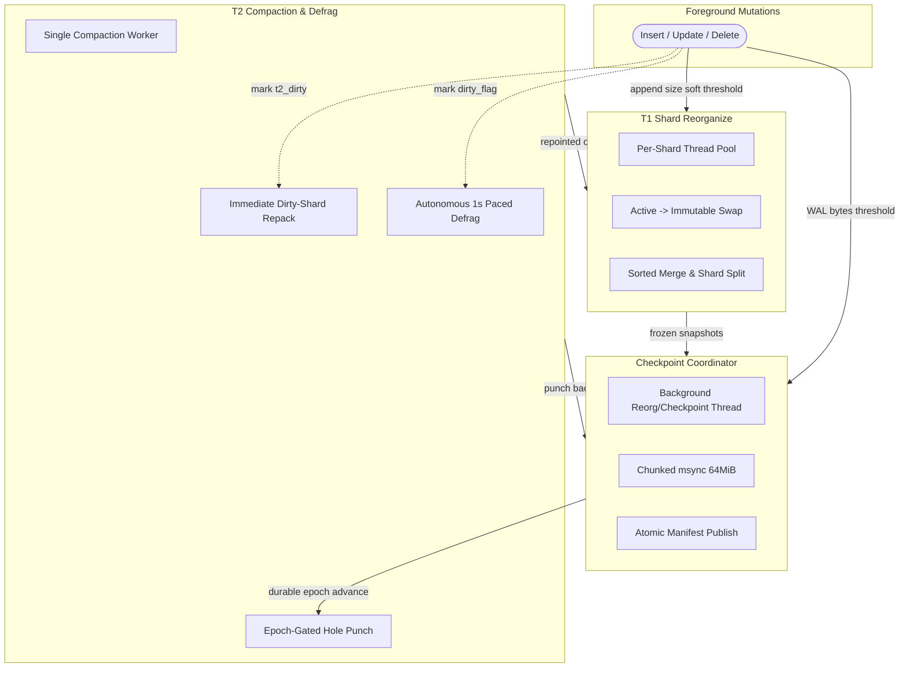

# vmemkv Background Maintenance Architecture

## 1. Overview & Guarantees

vmemkv delegates cache replacement and paging to the OS virtual-memory subsystem, but decouples internal maintenance into three independent background subsystems to eliminate foreground write stalls and bound storage overhead:

1. **Tier-1 Shard Reorganize**: Eliminates in-memory ordering fragmentation within T1 index shards.
2. **Checkpoint Coordinator**: Persists the mutable Tier-2 tail log to disk, publishes durable checkpoints, and bounds WAL replay duration.
3. **Tier-2 Compaction & Autonomous Defragmentation**: Restores sequential physical locality for scans, evacuates sparse garbage segments, and hole-punches reclaimed filesystem blocks.



### Responsibility and Guarantee Summary

| Subsystem | Primary Guarantee | Execution Model | Trigger Mechanism |
|---|---|---|---|
| **T1 Shard Reorganize** | Preserves $O(\log N)$ binary search latency and L2 cache locality across index growth. | Per-shard worker thread pool (isolated per shard). | Shard `append_size()` reaches soft threshold ($8192$ entries, or $1024$ during active scans) or tombstone threshold. |
| **Checkpoint Coordinator** | Bounds crash-recovery WAL replay to $\le 64\,\text{MiB}$ and freezes immutable T2 base data. | Single-flight execution on dedicated background worker. | WAL bytes $\ge 64\,\text{MiB}$ or emergency punch backlog cap ($1058$ segs). |
| **T2 Compaction & Defrag** | Restores 4KiB-page locality for scans; reclaims unreferenced physical SSD space without writer stalls. | Single dedicated background worker (`compact_worker_`). | **Immediate**: Dirty-shard page-locality repair (`t2_dirty`).<br>**Paced (1s)**: Unreferenced segment garbage (`dirty_flag_`). |

---

## 2. Tier-1 Shard Reorganize

### 2.1 Purpose & Guarantees
Tier-1 index shards receive new inserts into an unsorted `append_region`. Unchecked growth inflates lookup and scan costs from $O(1) + O(\log N)$ toward $O(N_{\text{append}})$. T1 Reorganize guarantees:
- Bounded append size: Restores pure $O(\log N)$ sorted lookup performance.
- Tombstone reclamation: Purges deleted entries without leaving lingering memory overhead.
- Autonomous shard splitting: Halves oversized shards when `sorted_region` exceeds target capacity.

### 2.2 Mechanism & Components
- **Generation Switching**: The active append region rotates to an immutable generation under an atomic pointer swap, allowing concurrent writes to continue immediately into a fresh append buffer.
- **Merge & Shard Split**: The worker merges the immutable append generation with the existing `sorted_region` into a new contiguous array. If the resulting entry count exceeds the split threshold, the shard splits into two key-partitioned child shards.
- **FreezableRegion (Lost-Update Protection)**: While a merge runs, in-place updates to keys present in the snapshot bypass the old array and append to the new active generation, preventing concurrent mutations from being overwritten by the merge output.
- **Epoch Drain**: Old sorted and append buffers are deallocated only after all in-flight readers exit via hazard/epoch tracking (`with_epoch_guard`).

---

## 3. Checkpoint Coordinator

### 3.1 Purpose & Guarantees
Tier-2 storage operates over a `MAP_SHARED` sparse flat file. Mutations land directly in the Linux page cache. Checkpoint guarantees:
- Durability: Flushes uncommitted page cache writes in `[old_base, target)` to physical storage.
- Startup Bounding: Replays at most $64\,\text{MiB}$ of WAL logs on reboot.
- Base Region Invariance: Advances `base_boundary`, rendering flushed T2 segments permanently immutable and enabling seqlock-free, direct zero-copy reads.

### 3.2 Mechanism & Components
- **Chunked Synchronization**: Synchronizes dirty log ranges using `msync(MS_SYNC)` in chunks of $64\,\text{MiB}$ (`kMsyncChunkBytes`), cooperatively calling `std::this_thread::yield()` between chunks to prevent kernel I/O queue monopolization.
- **Atomic Manifest Publication**: Writes the snapshot manifest to a temporary file and atomically replaces `manifest.json` via filesystem `rename()`.
- **WAL Log Rotation**: Truncates and advances active WAL log segments past the checkpointed LSN, recycling disk space.
- **Trigger Condition**:
  $$\text{Checkpoint\_Trigger} = \text{WAL} \ge 64\,\text{MiB} \lor \text{Backlog} \ge 1058 \lor \text{Force}$$

---

## 4. Tier-2 Compaction & Autonomous Defragmentation

### 4.1 Purpose & Guarantees
Out-of-place updates and deletions leave unreferenced records and physical offset disorder in Tier 2. Compaction guarantees:
- Sequential Locality for Range Scans: Restores ascending physical offset order to optimize hardware readahead and OS sequential prefetching.
- Physical Space Reclamation: Eliminates unreferenced records from sparse segments, freeing disk space via filesystem hole-punching.
- Writer Non-Interference: Bounds defragmentation throughput during steady-state ingestion so foreground throughput is never throttled by background GC.

### 4.2 Two-Tiered Tracking and Work Sourcing
1. **Dirty Shard Flags (`t2_dirty`)**:
   - Shards receiving T2 appends flag their state in T1 routing directory slots. Compaction inspects in-memory shard entries in key order and relocates only records whose T2 pages are non-local with their predecessor or successor (`are_t2_payloads_page_local`).
2. **Autonomous Garbage Flags (`dirty_flag_`)**:
   - Updates and deletes atomically mark bit flags corresponding to the modified 8MiB segment (`mark_record_segments_dirty()`). No queue allocations or locks occur on the write path.

### 4.3 Dual-Cadence Execution Model
A single dedicated worker thread (`compact_worker_`) executes `compaction_worker_loop()` via `poll_worker_until_stop()`:

```cpp
// vmemkv_impl.hpp
return t2_own_.has_dirty_segments() || t1_.has_dirty_shard();
```

- **Immediate Drain Mode (Active Need)**:
  When `t2_dirty` requires page-locality repair or explicit dirty segments are queued, the loop returns `true`. The worker loops without sleeping, repairing shard locality to restore sequential scan performance.
- **Rate-Limited Mode (Steady-State Pacing)**:
  When explicit queues are empty, the worker searches `dirty_flag_` via `find_garbage_segment(base_boundary)` for segments with dead bytes below the immutable base boundary. It evacuates at most one segment, then returns `false` to enforce a strict 1-second idle sleep (`kCompactionPoll1s`). Writer bandwidth remains unconstrained.

### 4.4 Relocation & Epoch-Gated Hole Punching
- **Stripe-Locked CAS Relocation**: Live records are copied to the append frontier in key order. T1 slot offsets are updated under the key's stripe lock with CAS validation. If a concurrent foreground update has already updated the slot, the relocation safely discards its copy as stale.
- **Hole Punching (`fallocate`)**: Empty 8MiB segments (`seg_live == 0`) enter `punch_head_`.
- **Epoch Gate Rule**: A candidate segment is eligible for physical hole punching (`FALLOC_FL_PUNCH_HOLE`) only after two subsequent checkpoints have completed since evacuation (`evacuated_epoch + 2 <= current_durable_epoch`). This guarantees that no concurrent readers or recovering boot processes can reference the deallocated physical offset.

---

## 5. Inter-Job Relationships & Coordination

### 5.1 Mutual Exclusion and Concurrency Matrix

| Job A / Job B | T1 Shard Reorganize | Checkpoint Coordinator | T2 Compaction Worker |
|---|---|---|---|
| **T1 Shard Reorganize** | Concurrent (independent per shard) | Serialized on shared `trigger.running` slot | Concurrent (coordinate via T1 stripe locks) |
| **Checkpoint Coordinator** | Serialized on shared `trigger.running` slot | Single-flight | Concurrent (coordinate via `base_boundary` snapshot) |
| **T2 Compaction Worker** | Concurrent (coordinate via T1 stripe locks) | Concurrent (coordinate via `base_boundary` snapshot) | Single-flight (`compact_.running`) |

### 5.2 Ordering & Safety Rules
1. **Lock Hierarchy**: Key Stripe Lock $\rightarrow$ Shard Routing Guard $\rightarrow$ T2 Ownership Stack. Workers never acquire locks in reverse order.
2. **Zero-WAL Relocation**: Compaction relocations never write to the WAL. Durability of relocated records is established exclusively through subsequent checkpoints.
3. **Immutable Base Decoupling**: Checkpoint and Compaction exclusively mutate the tail region and base index pointers; the physical byte content of the base region remains completely immutable.

---

## 6. Files

- `src/vmemkv/impl/compaction.hpp`: T2 segment evacuation, shard repacking, and hole-punch execution.
- `src/vmemkv/impl/t2_ownership.hpp`: Lock-free Treiber stacks for dirty/punch segments and per-segment live-byte tracking.
- `src/vmemkv/impl/checkpoint_coordinator.hpp`: Chunked msync, trigger pacing, and manifest management.
- `src/vmemkv/t1_index/sharded_t1_index.hpp`: Per-shard maintenance scheduling, generation swapping, and split execution.
- `src/vmemkv/vmemkv_impl.hpp`: Worker thread lifecycle and dual-cadence compaction loop.
