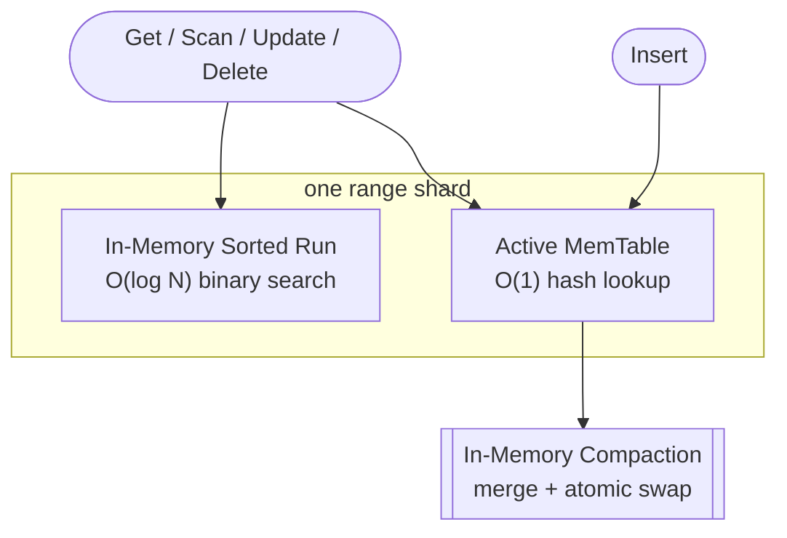
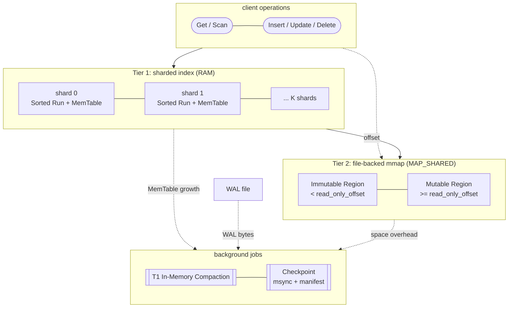

# vmemkv High Level Design

## 1. Overview

vmemkv is a larger-than-memory KVS that delegates data management to the OS virtual-memory subsystem (`mmap`, `madvise`, `msync`) as much as possible. It consists of the following components.

- Tier 1: RAM-resident index layer
- Tier 2: large-capacity data layer on file-backed mmap
- WAL
- Checkpoint
- Background Jobs

vmemkv's goal is to leave the buffer pool, page replacement algorithms, complex compactions, and the like to the OS, keeping the implementation simple while securing production-usable performance. It aims for LSM-tree (RocksDB, LevelDB) class performance with Bitcask-like design simplicity, handling larger-than-memory data beyond LMDB's reach.

## 2. Features and Limitations

### 2.1 What It Does

- Larger-than-memory data operation
- Get / Insert / Update / Delete / Scan KVS API
- Durability via WAL and checkpoint

### 2.2 What It Does Not Do

- Multi-operation transactions
- Phantom avoidance

## 3. Common Architecture: Dual-Buffer / Reorganizing Two-Region

vmemkv's core T1 index structure pairs an **In-Memory Sorted Run** (`sorted_run_`) with an **Active MemTable** (`memtable_active_`), where periodic **In-Memory Compaction** (`reorganize()`) absorbs the MemTable into the single Sorted Run (see [`terminology.md`](terminology.md)).

- **In-Memory Sorted Run** (`sorted_run`): sorted array. Lookups are O(log N) with Bloom filter miss bypass.
- **Active MemTable** (`memtable_active`): unsorted write region. With a combined hash index, lookups are O(1) expected and writes are O(1).

Shape language: `[box]` = component/region, `([rounded])` = instruction, `{diamond}` = decision, `[[double box]]` = background job.

The basic behavior of this structure is as follows.

- `insert` adds a new entry to the shard's `Active MemTable`
- reads check both `Active MemTable` (plus `Immutable MemTable` during compaction) and `Sorted Run`
- `update` and `delete` basically update in place once the target entry is found
- `reorganize` merges `Immutable MemTable` contents into `Sorted Run`, dropping old versions and tombstones

This structure makes the steady-state insert path a simple append, and the update path an in-place update of the existing entry. Unlike disk-backed multi-level LSM-trees, each shard keeps only one RAM-resident sorted run rather than stacking multiple disk runs.

## 4. Two-Tier Architecture

vmemkv consists of a Tier 1 holding a sharded MemTable/Sorted-Run index plus a Tier 2 value store referenced from Tier 1 offsets.

### 4.1 Tier 1

Tier 1 is a fixed-size index layer. An `IndexEntry` holds `key prefix + key hash + payload` and anchors point lookups and range scans. The key hash is the full key hashed. In the base design the payload is the `offset` pointing at Tier 2, described below.

Tier 1 specifics:

- fixed-size entries, easy to keep as a dense array
- `Sorted Run` is a key-ordered IndexEntry array, `Active MemTable` an unordered IndexEntry array.

Additionally, as an opt-in optimization, entries with values of 8 bytes or less support **entry-level adaptive covering**, interpreting the payload as a 64-bit value instead of an `offset`. For such entries `Get()` completes on the Tier 1 hit alone, skipping Tier 2 access. See low_level_design.md 2.1.1.

### 4.2 Tier 2

Tier 2 is the variable-length value layer aligned with FASTER's `HybridLog` terminology. Referenced by `offset` from Tier 1, it holds the actual key/value records across an **Immutable Region** (`[0, read_only_offset)`) and a **Mutable Region** (`[read_only_offset, tail_offset)`).

Tier 2 specifics:

- handles variable-size records
- kept as a single byte array on file-backed `MAP_SHARED` mmap; `offset` is the byte offset from its start
- inserts, and updates whose new value doesn't fit `alloc_len` or whose old record lies in the Immutable Region, append a new record at `tail_offset` and store its offset in Tier 1
- `update` rewrites the existing record in place inside the Mutable Region when possible, otherwise performs copy-on-write append
- carries larger-than-memory operation and durability via the OS page cache

Tier 1/Tier 2 responsibility split and the `offset`-connected layout:

## 5. Operation Examples

### 5.1 Get

1. Search Tier 1's `Active MemTable` / `Immutable MemTable` / `Sorted Run` for a candidate `IndexEntry`.

- Complexity is O(1) on a MemTable hit, plus O(log N) on a Sorted Run hit. A miss costs O(1) + O(1) Bloom check.

2. Verify the hash.

- Verified to distinguish keys sharing a prefix but differing after it.

3. Reference the Tier 2 record via `offset`.

- Tier 2 is a single byte array, referenced from `base + offset`.

4. Confirm the full-key match and return.

- Verified to distinguish actually-different keys with matching prefix and hash.

For inlined entries step 3. is unnecessary; the Tier 1 payload is returned directly.

### 5.2 Insert

1. `Get()` to check whether the entry already exists
2. Append a value record at Tier 2's `tail_offset`, obtaining the offset
3. Add an `IndexEntry` to Tier 1's `Active MemTable`, writing its offset
4. WAL append + `fsync`. Success is returned to the caller only after this `fsync` completes.

For inline-eligible entries of 8 bytes or less, step 2. is skipped and the 64-bit value is written directly into the Tier 1 entry's payload.

### 5.3 Update / Delete / Scan

- Update: locate the entry with `Get()`; rewrite the Tier 2 Mutable-Region record in place when it fits. When the existing record resides in the Immutable Region (`offset < read_only_offset`), updates to keys $\le$ 16 bytes immediately redirect to copy-on-write append without reading SSD immutable data (prefix containment guarantees full-key identity). Keys $> 16$ bytes verify the full key via `try_read_immutable_record()` before appending.
- Delete: locate the entry with `Get()`, write a Tombstone (`STORE_NOT_FOUND`) on Tier 1, then write the WAL. Tier 2 is untouched.
- Scan: narrow the range on Tier 1 first, then collect value records on Tier 2 in key order. Scan is purely read-only.

For inlined entries, Update / Delete / Scan complete on the Tier 1 payload alone.

For offset-payload indexes, Update and Delete leave old Tier 2 records unreferenced. Restoring 4KiB page locality within each T1 shard and reclaiming sparse Tier 2 segments via unified shard repacking and hole punching are handled by background jobs (see `background_jobs.md` and `t2_compaction_design.md`).

## 6. Background Jobs (Reorganize, Checkpoint, Compaction)

vmemkv coordinates two decoupled background maintenance mechanisms along the memory/storage boundary:

- **T1 Shard Reorganize (In-Memory Compaction)**: Per-shard worker pool merges `Immutable MemTable` into `Sorted Run`, eliminating ordering fragmentation in memory and splitting shards when they reach one T2 segment ($8\,\text{MiB}$) of referenced live bytes or the entry-count threshold.
- **T2 Maintenance (Checkpoint & Compaction)**: Single dedicated storage worker synchronizes Tier 2's Mutable Region to disk via chunked `msync(MS_SYNC)` with cooperative yielding, persists T1 checkpoint chunks + `MANIFEST`, advances `read_only_offset`, rotates the WAL, repacks dirty T1 shards (and shards overlapping garbage segments below $50\%$ live bytes) in full-key order to `tail_offset`, and hole-punches empty $8\,\text{MiB}$ segments after a two-checkpoint epoch gate.

See [`background_jobs.md`](background_jobs.md) for the unified design and lifecycle guarantees.

## 7. Fault Tolerance and WAL

vmemkv guarantees durability using logical redo with no undo log (tolerating OS page-cache writeback / `STEAL` and non-forced T2 data writes / `NO-FORCE`):

- Tier 1 is a pure in-RAM structure rebuilt on boot from the T1 checkpoint files (when present) plus WAL replay.
- Mutations apply to Tier 2 / Tier 1 first, and only on success WAL-append + `fsync`. Success is returned to the caller only after the WAL `fsync` completes, keeping failed applies out of the WAL (see low_level_design.md 3.2).
- Recovery trusts T2 only up to the manifest's `t2_bytes_used` (guaranteed complete and `msync`ed before publication) and discards/rebuilds anything beyond it by replaying WAL records through the ordinary write path (`write_entry_lockfree()`). Because old tail offsets are never referenced after replay, torn tail pages stolen to disk before crash are harmless and require no undo log.
- After checkpoint completes, the WAL rotates per low_level_design.md 5.5.

## 8. Optimization Overview

Several optimizations exist (the latter two are opt-in and operate correctly disabled). See [low_level_design.md](./low_level_design.md).

- Tier 2 `madvise(MADV_RANDOM)` (always on)
- Recommended paging regime for LTM operation (classic LRU; see low_level_design.md 7.6)
- WAL Group Commit (implemented; lock-free fixed-length ring-buffer scheme; see low_level_design.md 7.1)
- entry-level adaptive covering
- O(1) misses via Bloom filter for `SortedRun` negative lookups

## Appendix A. Relationship with LineairDB

vmemkv is designed to replace LineairDB's KVS portion.

- As-is: KVS composed of multiple elements including lock-free hashtable, PLI, WAL, CPR
- To-be: vmemkv alone as the KVS core

LineairDB is treated as a wrapper providing concurrency control and table/secondary-index features around vmemkv.
