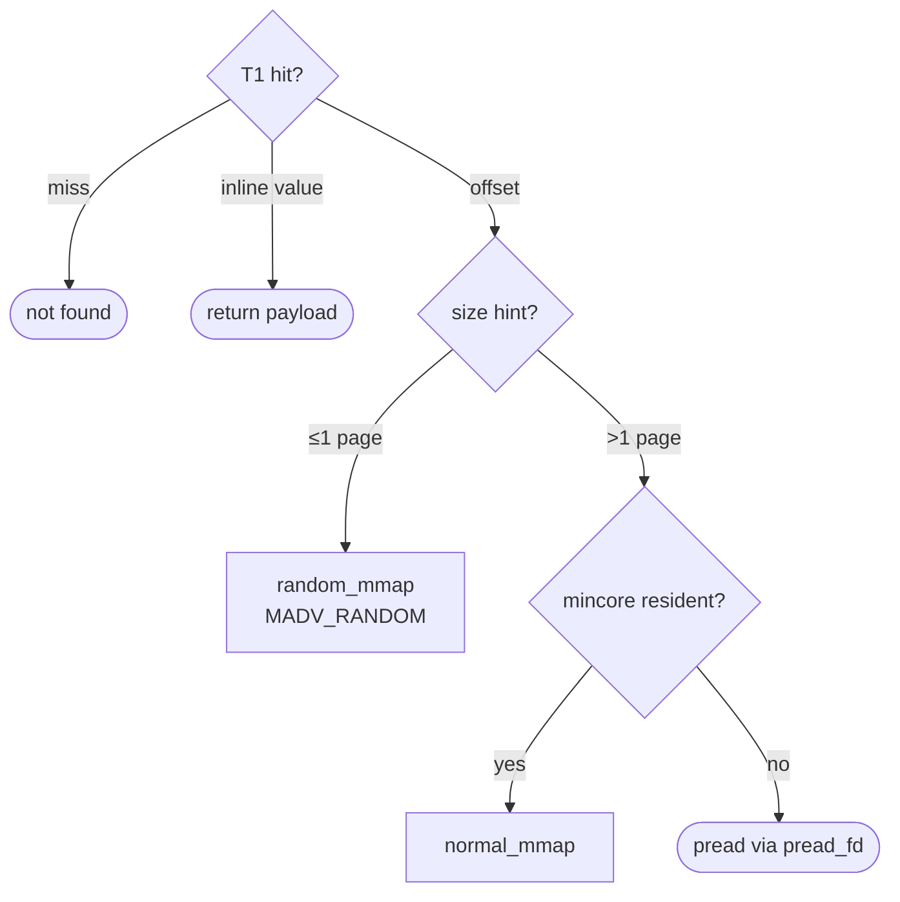
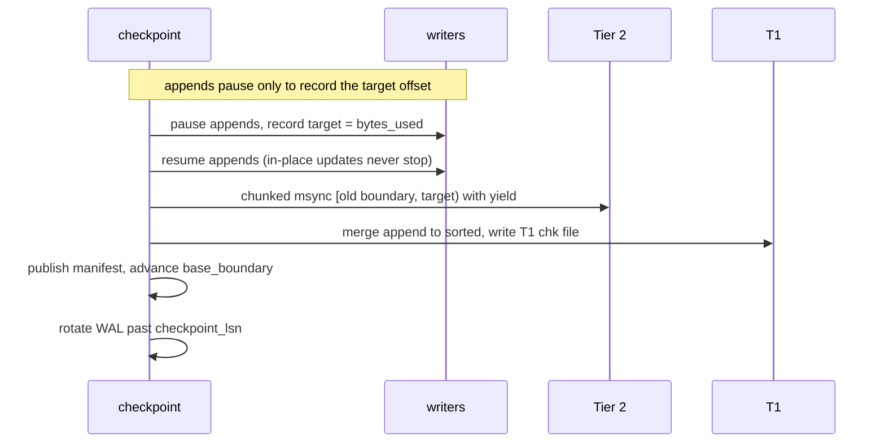
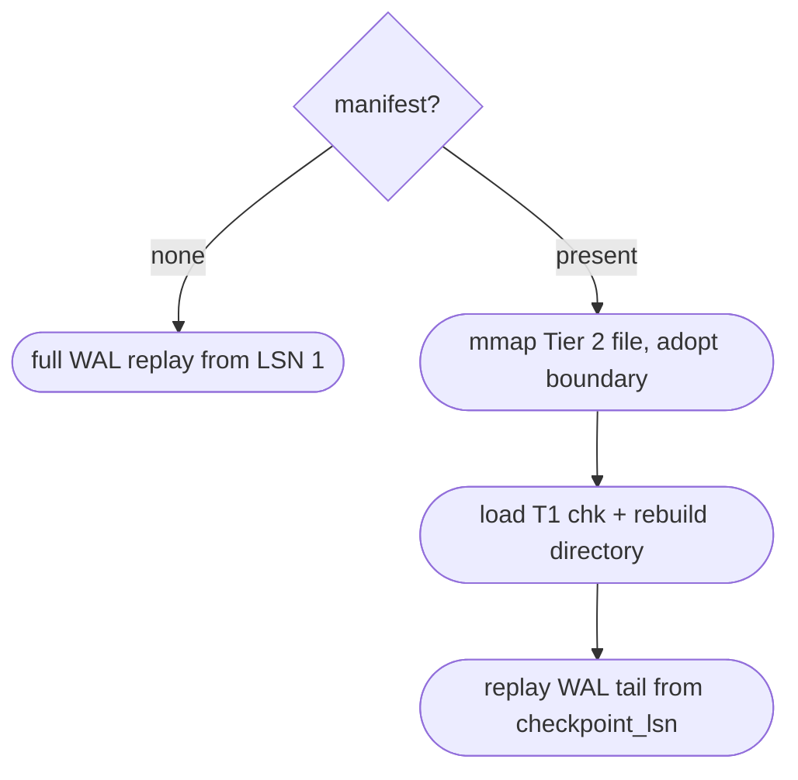

# vmemkv Low Level Design

## 1. Overview

Following [high_level_design.md](./high_level_design.md), this document defines vmemkv's low-level data layout, operation procedures, background processing, opt-in optimizations, and key parameters.

## 2. Core Data Structures

### 2.1 Tier 1

Tier 1 is an index layer holding fixed-size entries. It is implemented as a range partition over K independent shards, each independently holding the `sorted_region` / `append_region` pair described in this section. For the directory layer, split protocol, and cross-shard concurrency control see [`t1_sharding_design.md`](t1_sharding_design.md). Below, unless noted, internal structure and operations of one shard are described as a single T1 index.

`sorted_region` and `append_region` both hold entry arrays, but their field layout differs between the runtime and on-disk (checkpoint) representations.

**Conceptual model** (core fields common to both representations):

```c++
using StoreKeyPrefix = std::array<std::byte, 16>; // 16-byte key prefix

struct IndexEntry {
    StoreKeyPrefix key_prefix;  // primary sort key
    uint64_t hash;              // hash(full_key)
    uint64_t payload_bits;      // Tier 2 offset, or an entry-level inlined value (2.1.1)
};

constexpr uint64_t STORE_NOT_FOUND = ~0ULL; // tombstone marker
```

| Field | Meaning |
| --- | --- |
| `key_prefix` | Primary sort key. Decides Tier 1 ordering. |
| `hash` | Full-key hash. Narrows candidates indistinguishable by prefix alone. |
| `payload_bits` | Normally a Tier 2 byte offset. The value itself for entry-level inlined entries (2.1.1). `STORE_NOT_FOUND` is a tombstone. |

**Runtime representation**: `sorted_region` holds an array of `SortedSlot` (40 bytes: the 32-byte core fields above + `version`), `append_region` an array of `AppendSlot` (48 bytes: all `SortedSlot` fields + a `published` flag). `version` is the seqlock guaranteeing consistency during in-place updates (chapter 6). `hash`/`payload_bits`/`version` are all `std::atomic`, combining concurrent reads with in-place put() updates.

**On-disk (checkpoint) representation**: `T1ChkEntry` (32 bytes, core fields only). `version`/`published` serve runtime concurrency control only and are not persisted — a single-process load completes the checkpoint (5.4). `hash` is persisted as-is including the top 4 bits for inline decisions, still used to decode inline values after reload.

**Invariants**

- `sorted_region` is ascending in `key_prefix`.
- `append_region` is unordered.
- A Tier 1 live entry is expected to number at most 1 per logical key across `sorted_region` and `append_region` combined.
- Entries with `payload_bits == STORE_NOT_FOUND` are deleted; exclude them from Get / Scan results.

### 2.1.1 Dynamic Inline Optimizations

Tier 1 is an index holding 64-bit payloads. In the T1/T2 hybrid layout, values of 64 bits (8 bytes) or less skip the Tier 2 append write and store the value directly in T1's payload area — "dynamic inline optimization". For small values this skips disk I/O and mmap dereference entirely, reaching in-memory-KVS-class lookup speed.

(For concrete implementation approaches and their trade-offs see **"7.2 Entry-Level Adaptive Covering (Dynamic T1 Inline Optimization)"** below.)


### 2.2 Tier 2

Tier 2 is the value layer holding variable-length key/value records. It is kept as a single byte array on file-backed mmap, referenced by byte offset in Tier 1's `payload_bits`.

```c++
struct ValueRecordHeader {
    uint32_t key_len;
    uint32_t value_len;
    uint32_t alloc_len;     // allocated bytes for value payload
    uint64_t version;       // optional: debug / validation use
};

// Layout on disk / mmap:
// [ValueRecordHeader][key bytes][value bytes][padding up to alloc_len]

struct T2Store {
    std::byte* base;
    uint64_t bytes_used;      // next append offset
    uint64_t bytes_capacity;  // mapped byte length
};
```

**Offset Space**

- `base`'s start offset is `0`.
- `bytes_used` is the next record's append offset.
- Record offsets must satisfy `0 <= offset < bytes_used`.
- Record start offsets align to `alignof(ValueRecordHeader)` (8-byte) boundaries. Records of 1 page (4096 bytes) or less never cross a page boundary, skipping to the next page start when they would. Records over 1 page pack densely (no alignment gaps). Page-contained layout minimizes cold-read fault counts for sub-page records; multi-page records touch the same page count either way, while layout gaps would break Scan's readahead merging. Skipped blanks hold no live records, so `bytes_used` monotonicity, hole-punch eligibility, and live accounting are unaffected. Physical layout is 8-byte granular, but `payload_bits`' embedded block count is a 16-byte-granular size hint (`aligned_len / 16` truncated), at most 8 bytes short. Readers decide with a +16-byte margin over the hint. Huge records whose block count overflows 16 bits fail at append time, distinguished from capacity shortage.
- To reference a record offset, interpret `base + offset` as `ValueRecordHeader*` and read the following key bytes / value bytes.

**Payload Bit Layout**

When Tier 1's `payload_bits` is a Tier 2 offset (2.1), unused high bits embed the record size so base-region reads and segment live-byte accounting size spans with no extra T2 access. This form is always used for offset payloads, not opt-in.

* **Bits 0-47 (48-bit):** `T2 Offset` (record offset pointer in the physical file; maps up to 256 TiB of virtual address space).
* **Bits 48-63 (16-bit):** `Embedded Block Count` (record footprint block count in 16-byte alignment, `aligned_len / 16`). Maximum expressible size: $(2^{16} - 1) \times 16 \text{ bytes} \approx \mathbf{1.04 \text{ MB}}$.

Decoding: physical offset is `payload_bits & 0xFFFFFFFFFFFFULL`, record size is `(payload_bits >> 48) << 4`.

**Base/Tail Split**

`T2Store` holds `base_boundary`: the boundary value expressing the invariant that `[0, base_boundary)` is safely readable via base-region-only read paths (7.5 — three exist, by purpose/record size) with no seqlock. `base_boundary` advances atomically only through `checkpoint_internal()` (4.3).

- Records with `offset < base_boundary` are the **base** region, `offset >= base_boundary` the **tail** region.
- The base region is never rewritten in place once inside `base_boundary` (3.3). Base reads are therefore safe on dedicated read paths bypassing the main mmap's `MADV_RANDOM` (7.4), needing no seqlock (path selection: 7.5).
- The tail region may be updated in place as usual, so it is only safely readable via the main mmap (latest view, seqlock-guarded).

**Invariants**

- A Tier 2 live record is always reachable from some live `IndexEntry.payload_bits` on Tier 1.
- A Tier 2 record no longer referenced from Tier 1 is garbage. Storage reclamation is specified in `t2_compaction_design.md`; `bytes_used` only grows monotonically. Reclamation hole-punches; offset space is never reused.
- `update` overwrites the existing record in place when possible.
- When a new value exceeds `alloc_len`, a new record goes at `bytes_used` and Tier 1's `offset` is swapped.
- The `bytes_used` increment at append equals `ValueRecordHeader + key bytes + value bytes + padding (up to alloc_len)`, plus adjustment aligning the next record start to an `alignof(ValueRecordHeader)` boundary.
- Always satisfies `bytes_used <= bytes_capacity`.
- Capacity shortage at append (`bytes_used + required_bytes > bytes_capacity`) fails the write request (no queueing or automatic retry).

### 2.3 VMemKV State

```c++
struct VMemKV {
    ShardedT1Index t1;
    T2Store t2;
    Wal wal;
    T2Ownership t2_own;   // segment live-byte accounting, checkpoint watermark, in-place barrier
    ReorgState reorg;     // checkpoint/reorganize single-flight state
    // + key stripe 256, background workers (reorg/compaction/T1 pool), bulk-load throttle
};
```

After boot-time load or reorganize, `T1Index` / `T2Store` are rebuilt into the same shape. Boot order is `t1_(workers=0)` construction → T2 adopt → checkpoint load → `t1_.start_workers()` → WAL replay → worker start.

## 3. Read / Write Operations

This section's procedures assume `payload_bits` is a Tier 2 offset unless noted. For entry-level inlined entries (2.1.1), skip Tier 2 procedures and read/write Tier 1's `payload_bits` directly.

Shape language: `[box]` = component/region, `([rounded])` = instruction, `{diamond}` = decision, `[[double box]]` = background job.


### 3.1 Get

Input is the full key. Tier 1 narrows candidates by `key_prefix` and `hash`, Tier 2 confirms the full-key match.

**Procedure**

1. Compute `key_prefix = prefix(full_key)` and `hash = hash(full_key)`.
2. Search the hash index (`append_index`) tied to `t1.append_region` for candidates matching `key_prefix` and `hash`.
3. If append-side misses, binary-search `t1.sorted_region` by `key_prefix` for the candidate range (with opt-in Bloom filter, cut misses off at O(1)).
4. Verify `hash` on candidate `IndexEntry`s.
5. Not found if `payload_bits == STORE_NOT_FOUND`.
6. Fetch the Tier 2 record from `payload_bits`. Small records read directly from the main mmap (`random_mmap`); large records check residency (`mincore`) and split between mmap reads from `normal_mmap` and `pread()` via `pread_fd` (7.5).
7. Compare the Tier 2 record's full key, returning the value on match. Not found otherwise.



**Complexity**

- `O(1) + O(log |t1.sorted_region|)` expected

### 3.2 Insert

**Procedure**

1. Run `Get(full_key)`; continue if no existing entry.
2. Write a new `ValueRecord` at Tier 2's `bytes_used`, obtaining the logical `offset`.
3. Build `IndexEntry{key_prefix, hash, payload_bits}` and add it to Tier 1's `append_region`.
4. Append an insert record to the WAL and `fsync`. Success returns to the caller only after this `fsync` completes.

**Failure Rule**

- WAL-append only after Tier 1 / Tier 2 application (2.–3.) is confirmed successful. Never log operations that exceptions/failures left incomplete.
- Capacity shortage at 2. (`bytes_used + required_bytes > bytes_capacity`) fails the operation and logs nothing to the WAL (2.2).

### 3.3 Update

**Procedure**

1. Locate the target entry with `Get(full_key)`. Not found if absent.
2. Look at Tier 2's existing record.
3. If `new_value_len <= alloc_len`, update the Tier 2 record in place.
4. Otherwise add a new record at Tier 2's `bytes_used`, obtain the new `offset`, and rewrite the corresponding `IndexEntry.payload_bits` on Tier 1.
5. Append an update record to the WAL and `fsync`. Success returns to the caller only after this `fsync` completes.

**Notes**

- The old Tier 2 record is not deleted on the spot.
- The old Tier 2 record becomes unreachable from Tier 1; physical reclamation is specified in `t2_compaction_design.md`.
- Failure Rule as in 3.2: never log operations whose 2.–4. failed.
- Step 3's in-place decision also includes the `offset >= base_boundary` and `offset >= capture watermark` conditions (2.2). Updates to records below either boundary take the step-4 append path unconditionally, even when `new_value_len <= alloc_len` fits. The base region's dedicated-mmap direct-read paths (7.5) depend on "never rewritten", so this holds. When `offset < base_boundary`, keys $\le$ 16 bytes (`t1_detail::kPrefixBytes`) fall through to the append path immediately without reading SSD base data, because T1 prefix containment guarantees full-key identity without seqlock or page faults. Keys $> 16$ bytes verify the full key via `try_read_base_record()` to eliminate hash collision false positives before appending. `base_boundary` is an atomic advanced only by `checkpoint_internal()` (2.2), and this check is safe as a single atomic load — reading a stale value during advancement only ever errs safe (tail-side = append path) and never wrongly permits in-place writes into the base region.

### 3.4 Delete

**Procedure**

1. Locate the target entry with `Get(full_key)`. Not found if absent.
2. Rewrite the corresponding `IndexEntry.payload_bits` on Tier 1 to `STORE_NOT_FOUND`.
3. Append a delete record to the WAL and `fsync`. Success returns to the caller only after this `fsync` completes.

**Notes**

- Tier 2's record is untouched at delete time.
- Deleted records become unreachable from Tier 1 but are not physically deleted Tier 2-side — same as Update's Notes.
- Failure Rule as in 3.2: never log operations whose 2. failed.

### 3.5 Scan

**Procedure**

1. Acquire a `ScanActiveGuard`. While held, the shard maintenance soft threshold drops to the L2 cache size cap.
2. Walk all of Tier 1's `append_region`, gathering in-range `IndexEntry`s as candidates.
3. Binary-search Tier 1's `sorted_region` by `key_prefix`, enumerating in-range candidates.
4. Confirm `payload_bits != STORE_NOT_FOUND` per candidate. Inline entries restore the value by byte-copying `payload_bits` per `inline_size`, restoring the key by trimming trailing zeros of the 16-byte prefix.
5. Read T2 records sequentially for non-inline candidates in T1's yield (key) order.
6. Fetch Tier 2 records from `payload_bits`.
7. Compare full keys, returning only in-range records.

**Notes**

- `key_prefix` is only a coarse filter.
- Full-key comparison happens on Tier 2. Inline entries complete on Tier 1 alone.
- The scanned range is half-open: matches satisfy `lower <= key < upper`.
- A callback returns `ScanControl::Continue` to visit the next match or `ScanControl::Stop` to end the scan.
  The returned count includes the entry whose callback returns `Stop`; void-returning callbacks continue.

### 3.6 Bulk Load

`bulk_load()` ingests entries via `write_entry_lockfree()`, bypassing the WAL.
No post-crash durability guarantee; only portions followed by `checkpoint()`
become durable. T1-only reorganize fires normally on the soft threshold. T2
appends mark their T1 shards dirty for background compaction, which can process
them while ingestion continues. Concurrent calls with other writers are
disallowed. Ingest pacing is throttled by `CgroupMemoryThrottle` under cgroup v2
memory pressure.

## 4. Reorganize

### 4.1 Purpose

`reorganize` resolves Ordering Fragmentation: Tier 1 `append_region` growth inflates candidate search/verification cost, slowing Get / Scan.

Tier 2 also holds Storage Fragmentation (old Tier 2 records unreferenced from Tier 1 from delete and append-update, plus key-order vs physical-offset correlation decay from out-of-place writes). `checkpoint_internal()` (4.3) does not resolve it; T2 compaction (`t2_compaction_design.md`) does.

### 4.2 T1 Reorganize

T1 `reorganize` runs independently of T2.

**Input**

- Current `t1.sorted_region`
- Current `t1.append_region`

**Output**

- New `t1.sorted_region`
- Empty `t1.append_region`

**Procedure**

1. Read out all `IndexEntry`s of `sorted_region` and `append_region`.
2. Drop entries with `payload_bits == STORE_NOT_FOUND`.
3. Sort by `key_prefix`.
4. Resolve duplicate keys as needed.
5. Build the new `sorted_region`.
6. Empty `append_region`.
7. Fully clear (reinitialize empty) the hash index (`append_index`) tied to `append_region`.

**Effect**

- Resolves Ordering Fragmentation.
- Removes deleted entries from Tier 1.

### 4.3 T2 Checkpoint (`checkpoint_internal()`)

Entries inlined entry-level (2.1.1, 7.2) never touch Tier 2 and are outside this procedure's scope.

`checkpoint_internal()` persists the tail region (`[old_base_boundary, bytes_used)`) of Tier 2's single persistent file with `msync()` and commits the matching T1 checkpoint and manifest. T2 repack and segment reclamation run in the background (see 4.5).

**Input**

- Dirty pages in Tier 2's `[old_base_boundary, bytes_used)`
- T1's current `append_region`

**Output**

- Advanced `base_boundary`
- T1 checkpoint file (5.4)

**Procedure**

1. Read `checkpoint_lsn = wal.next_lsn() - 1` (5.3).
2. Briefly stop new appends (`stop_writers_and_wait()`), fixing `bytes_used` at this point as `target`.
3. Immediately resume new appends (`resume_writers()`). In-place updates never stop during this procedure.
4. Store `target` in `capture_watermark_` and drain in-flight in-place writes to the target range with `InPlaceUpdateBarrier::wait_until_retired(target)`. Later in-place updates are allowed only at `offset >= base_boundary` and `offset >= capture_watermark_`.
5. `msync(MS_SYNC)` `[old_base_boundary, target)` in chunks of `kMsyncChunkBytes` (64 MiB), yielding (`std::this_thread::yield()`) between chunks. Round the start down to a page boundary; tolerate redundant re-syncs overlapping the previous cycle as idempotent.
6. Per shard, merge `append_region` into `sorted_region` via `checkpoint_all_shards()` (empty-append sorted-dump shortcut, pause+retry mid-split), writing out the T1 checkpoint file (temp + `rename`, 5.4). Pass the identity mapping that never rewrites `payload_bits`.
7. Read the current `bytes_used` frontier (covering every offset the step-6 snapshot names) and write it with `checkpoint_lsn` to the manifest (5.3).
8. Atomically advance `base_boundary` to `target`.
9. Call `Wal::rotate_segment()` (5.5). No arguments. Generation-sequence switching only; `checkpoint_lsn` is not passed.

**Effect**

- Persists Tier 2's tail region, advancing `base_boundary`.

- Merges T1's `append_region`, updating the T1 checkpoint file.
- Does not resolve Storage Fragmentation (4.1).



### 4.4 Reorganize / Checkpoint Trigger

The triggers starting automatic `checkpoint()` are WAL size and the emergency punch backlog cap:

$$\text{Checkpoint\_Trigger} = \text{WAL\_Bytes} \ge \text{WAL\_MAX\_BYTES} \lor \text{Backlog\_Cap\_Reached} \lor \text{Force}$$

* **`WAL_MAX_BYTES`**: 64 MiB appended to the WAL since the last checkpoint, bounding startup WAL replay time. Fires immediately.
* **`Backlog_Cap_Reached`**: queued punch candidates $\ge$ 1,058 segments (`kPunchBacklogCheckpointCapSegments`), bounding unreclaimed space.
* **`Force`**: explicit `checkpoint()` call.
* The public API is **`reorganize()`** (T1-only in-memory merge, untouched T2, no checkpoint) and **`checkpoint()`**. `checkpoint()` calls `checkpoint_internal()`.

| API | Effect |
|---|---|
| `reorganize()` | T1 Append→Sorted merge only. No T2/disk involvement |
| `checkpoint()` | Persists Tier 2's tail in place, commits the manifest, rotates the WAL |

### 4.5 T2 Compaction

The background compaction worker operates in two distinct execution modes:
- **Immediate drain**: When on-demand segment repair requests (`dirty_segments`) or shard key-order repairs (`dirty_shard`) are present, the worker loops continuously without delay to restore sequential scan performance.
- **Rate-limited defragmentation**: During steady-state write workloads without scan requests, the worker evacuates garbage segments at a paced 1-second cadence (`find_garbage_segment()`), preventing compaction loops from consuming writer bandwidth.

Relocations update T1 via stripe-locked CAS without emitting WAL records. Hole punching reclaims 8MiB segments whose live-byte count is zero after an epoch gate (two completed checkpoints). See `t2_compaction_design.md` and `background_jobs.md` for full design and coordination details.

### 4.6 T1 Reorganize Auto-Trigger

Each shard's `append_region` is watched independently by a dedicated background worker thread pool. When a shard's `append_size()` reaches `maintenance_soft_threshold(append_capacity, scan_active)`, only that shard enters the maintenance queue, and a worker runs `reorganize()` (splitting as needed). Neither other shards nor caller threads block. For delete-heavy cases where append never swells, `tombstones_since_maintenance >= target_shard_size` also enqueues. See [`t1_sharding_design.md`](t1_sharding_design.md)'s background-worker-thread-pool section.

## 5. Checkpoint Reload

### 5.1 Motivation

T2's live mmap is `MAP_SHARED` (NOTE below). Writes land directly in the page cache, so `checkpoint_internal()` (4.3) only settles tail-region reflection to physical disk with `msync()`. At boot, with a valid checkpoint (manifest), the same persistent file is directly `mmap`ed and adopted as the live one.

> [!NOTE]
> T2's mmap uses `MAP_SHARED | MAP_NORESERVE | PROT_READ | PROT_WRITE`. `MAP_NORESERVE` keeps the kernel from bulk-reserving swap at mmap time. This avoids ENOMEM when securing virtual address space far beyond physical RAM (e.g. 64 GB). Physical pages allocate on demand at access time and swap out normally.

### 5.2 Flow (Startup)

1. Read the manifest. With none, or on read failure, create Tier 2's persistent file anew and replay the whole WAL from LSN 1 (skip the rest).
2. `mmap` Tier 2's persistent file, adopting `base_boundary` = `manifest.t2_bytes_used`.
3. Read the T1 checkpoint file (5.4), rebuilding the directory and each shard's `sorted_region`.
4. Replay the WAL tail from after `checkpoint_lsn` to the end.

**Hash Index Lifecycle in Checkpoint**

- Right after checkpoint `append_region` is empty (size = 0), so the T1 checkpoint file sequentially writes only `sorted_region` data; the `append_index` state itself is never serialized (persisted).
- At boot, a freshly mapped T1 instance starts with `append_index` initialized empty, registering/updating the hash index as WAL replay and new client writes require.



### 5.3 Correctness Rule

- Checkpoint LSN selection: read `checkpoint_lsn = wal.next_lsn() - 1` once, **before** 4.3 step 2's writer stop. Since Insert / Update / Delete WAL-append after T1 / T2 application (3.2), operations already WAL-LSN-assigned at this read are guaranteed to have completed their T1/T2 application.
- Underestimating the checkpoint LSN (conservative) is allowed: startup WAL tail replay reapplying entries already in the checkpoint is side-effect-free and safe under `T1Index::put()`'s overwrite-in-place semantics (idempotent).
- Never overestimate the checkpoint LSN: it would skip valid updates unreflected in the checkpoint during tail replay, losing data.
- Write `t2_bytes_used` = the frontier read after the T1 merge snapshot to the manifest only after `[old_base_boundary, target)`'s `msync(MS_SYNC)` succeeds. The manifest frontier therefore covers every offset the T1 snapshot names; the sparse clone copy bounded by it never truncates file-referenced bytes. Bytes past `target` are WAL-durable (not msync'd); adoption and clones cover them since T1 already points into them.
- Until the manifest is `rename()`d onto its official path, never trust Tier 2 file contents beyond the manifest's `t2_bytes_used`, however physically written.
- Tier 2's checkpoint file physically holding bytes (file size) only needs to be **at or above** the manifest's `t2_bytes_used` (capacity may expand ahead of live data).

### 5.4 T1 Checkpoint File Format (`t1_index.chk`)

The T1 checkpoint file, like Tier 2, assumes "mmap and use immediately" — a parse-free flat array format serializing each of the K shards' `sorted_region` plus inter-shard boundary keys into one file.

**File Layout**

The writer cannot fix total shard counts / boundary keys until finishing per-shard entry counts, so the header sits at the end as a **trailer**:

```
[entry_count: uint64][IndexEntry] * entry_count   -- shard 0 (sorted ascending by key_prefix)
[entry_count: uint64][IndexEntry] * entry_count   -- shard 1
...                                                -- repeated shard_count times
[T1ChkKeyPrefix] * boundary_count                  -- shard boundary keys (shard_count - 1)
[ShardedT1ChkFileHeader]                           -- trailer
```

```c++
struct ShardedT1ChkFileHeader {
    uint32_t magic;             // format identifier
    uint8_t  format_version;
    uint8_t  reserved[3];
    uint64_t shard_count;
    uint64_t boundary_count;    // == shard_count - 1
    uint64_t total_entry_count; // entry_count sum over all shards
    uint64_t checksum;          // FNV-1a64 over all shard ranges + boundary keys + header (minus checksum)
};
// IndexEntry shares 2.1's layout, fixed 32B
```

### 5.5 WAL Rotation

The WAL is a numbered segment run `<wal_path>.<generation>`. `Wal::rotate_segment()` takes no arguments. It needs no `checkpoint_lsn` knowledge and walks no records.

**Procedure**

`Wal::rotate_segment()` wins the group-commit leader right (`flushing_` atomic exchange) and executes the following.

1. Opens the new generation `active_generation_ + 1` segment with `O_RDWR | O_CREAT | O_EXCL | O_APPEND`.
2. Publishes the new fd as the active fd, advances `active_generation_`, releases leader rights. No prior `drain_pending()`. Records reserved just before the swap land correctly in either old or new segment. `replay()` reads all on-disk segments in generation order.
3. Closes the old fd under `fd_close_mu_`.
4. Deletes the segment two generations back `(new_generation - 2)`. At most 2 generations remain on disk at steady state.

**Notes**

- `next_lsn_` never changes inside `rotate_segment()`. The in-memory atomic counter is the true value.
- `size_bytes()` is the active segment's `fstat` value, feeding 4.4's WAL size trigger. Because `rotate_segment()` starts an empty active segment every checkpoint cycle.
- Retention: checkpoint cycles are single-flight on `trigger.running`, and this call retires only the generation active in the previous cycle. The current cycle's `checkpoint_lsn` covers everything reserved by the last rollover, so the previous generation lies within the committed manifest's range.

## 6. Concurrency Contract

### 6.1 Base Assumption

Point operations normally proceed online. Checkpoint completes on a brief new-append quiesce (`stop_writers_and_wait()`) alone, needing no dedicated stop-the-world. T1 `reorganize` runs on an atomic pointer swap mechanism, likewise needing no dedicated stop-the-world.

This section defines not concrete sync mechanisms but which operations race with which, and what each race must guarantee.

### 6.2 Required Guarantees

- Get / Scan run online normally.
- Insert / Update / Delete WAL-append + `fsync` after T1 / T2 application.
- T1-only `reorganize` may run frequently, independently of T2.
- Checkpoint needs only brief new-append quiesce; in-place updates never stop meanwhile.
- T1 `reorganize` takes effect once its atomic pointer swap completes. No dedicated stop-the-world occurs.
- Operations spanning the pointer swap keep consistency via retry, snapshot, or serialization.

### 6.3 Operation Concurrency Matrix

The table below defines concurrent-execution eligibility and handling per operation pair.

- `Allowed`: free concurrent execution with no special stops
- `Allowed with brief stall`: only new-append issuance may briefly pause during Checkpoint's `stop_writers_and_wait()` window. Operations completing in place never stop.
- `Allowed with retry/snapshot`: free concurrent execution, but snapshot reads or retries needed
- `Serialized`: must serialize on the same key
- `Single-flight`: on concurrent calls, elect exactly one executing thread (leader). Follower behavior differs by path: soft paths continue without waiting, hard paths wait for leader completion (atomic-flag controlled).

`T1 reorganize` triggers inside `reorganize()` on the atomic pointer swap mechanism. `Checkpoint` completes on a different mechanism (brief new-append quiesce + `msync()`), but shares the same `trigger.running` single-flight lock for manifest-write exclusion.

| Operation A / B | Get | Scan | Insert | Update/Delete | T1 reorganize | Checkpoint |
| --- | --- | --- | --- | --- | --- | --- |
| `Get` | Allowed | Allowed | Allowed | Allowed | Allowed with retry/snapshot | Allowed |
| `Scan` | Allowed | Allowed | Allowed | Allowed | Allowed with retry/snapshot | Allowed |
| `Insert` (distinct key) | Allowed | Allowed | Allowed | Allowed | Allowed with retry/snapshot | Allowed with brief stall |
| `Insert` (same key) | Allowed | Allowed | Serialized | Serialized | Allowed with retry/snapshot | Allowed with brief stall |
| `Update/Delete` (distinct key) | Allowed | Allowed | Allowed | Allowed | Allowed with retry/snapshot | Allowed |
| `Update/Delete` (same key) | Allowed | Allowed | Serialized | Serialized | Allowed with retry/snapshot | Allowed |
| `T1 reorganize` | Allowed with retry/snapshot | Allowed with retry/snapshot | Allowed with retry/snapshot | Allowed with retry/snapshot | Single-flight | Single-flight (same slot) |
| `Checkpoint` | Allowed | Allowed | Allowed with brief stall | Allowed | Single-flight (same slot) | Single-flight |

### 6.4 Conflict Resolution Rules

#### Point Operations vs Point Operations

- Insert / Update / Delete on the same key must serialize.
- Point operations on different keys may proceed independently.
- Get / Scan may race in-flight Insert / Update / Delete, but observations must be either the "old state" or the "new state" — never a corrupted intermediate.

#### T1 Reorganize vs Readers

- Get / Scan may run concurrently with T1 `reorganize`.
- Readers must keep consistency by either
  - reading through the old `sorted_region` / `append_region` snapshot
  - or detecting the switch and retrying.

#### T1 Reorganize vs Writers

- Insert / Update / Delete may run concurrently with T1 `reorganize`.
- Writes a writer issues against old-generation buffers (reserve & publish) are fully drained by the first-stage epoch sync barrier (`wait_until_epoch`) the merge thread runs before starting the merge. This distributes every in-flight update safely to old or new generation with no writer-side retry or explicit lock sync, losing no data.
- This drain covers only `append_region` (active/immutable generation switching). In-place updates to keys **already in `sorted_region`** are guarded by a separate mechanism (`FreezableRegion`): between a merge snapshotting that key's value and publishing the new `sorted_region`, writes to that key pass through `sorted_region` (treated undetected) and bypass into an append to the new `append_region`. Without bypass, in-place updates landing after the snapshot but before publish would miss the new `sorted_region` and silently drop (Lost Update).

#### Checkpoint vs All Operations

- Checkpoint only briefly stops new appends; in-flight in-place updates and record relocation need nothing.
- New appends pause issuance only during `stop_writers_and_wait()`'s window, resuming once `bytes_used` is fixed.
- `base_boundary` advances only after the manifest's `rename()` completes (5.3).

### 6.5 Implementation Contract

This document does not mandate mutex-free implementation. The requirement is satisfying 6.2–6.4's concurrency contract, not the sync mechanisms' names.

## 7. Optimizations

Adaptive covering, Bloom filter, Group Commit, `MADV_RANDOM`, base-region-only read paths, and page-contained layout are enabled in the system configuration.

### 7.1 Group Commit

`Wal` group-commits on a fixed-length ring buffer (`kWalRingCapacity = 4096`).

- Each `reserve_*()` fixes its LSN with atomic `fetch_add` and CAS-publishes the record pointer into its slot (`lsn % capacity`).
- An active batch leader drains all waiting records, writes with `writev()` (split per IOV_MAX), and `fdatasync()`s once per batch.
- Batching adapts to load: under concurrency, the leader gathers in-flight writes while followers await batch completion under condition variable synchronization, amortizing fsync cost without introducing artificial sleep delays under low concurrency.
- Wakeup is one store to the atomic counter `highest_settled_lsn_` + `notify_all()`. Followers check `highest_settled_lsn_` and wait under `settled_mutex_` + `settled_cv_` if their LSN has not settled.
- `fd_close_mu_` guards only `rotate_segment()`'s `close(old_fd)` vs `size_bytes()`' `fstat(fd_)`. It never touches the write/fsync path.
- Record lifetimes use intrusive reference counting.

### 7.2 Entry-Level Adaptive Covering (Dynamic T1 Inline Optimization)

The optimization dynamically switching T2 offsets and inline 64-bit values per entry. Values of 8 bytes (64 bits) or less bypass Tier 2 writes, storing the value directly in the T1 index's payload area.

This optimization is enabled by every `vmemkv::Config` configuration.

#### 7.2.1 Metadata and Hash Encoding
T1's index slots lack spare bit area, so the 64-bit hash field's (`hash`) top 4 bits are reused as metadata, holding flags and size info.

- **Bit 63 (`is_inline`)**: `1` means inline data, `0` means a T2 offset.
- **Bits 62-60 (`inline_size`)**: inline data byte size (1–8 bytes). Size `8` encodes as `0`.
- **Bits 59-0 (`clean_hash`)**: the actual 60-bit FNV hash key. Index search, Bloom filter registration/decision, and hash comparison mask off the top 4 bits and compare only this 60-bit part.

#### 7.2.2 Inline Behavior
- **Distinguishing from T2 offsets (decision)**:
  - On read, checking the slot hash's top bit (Bit 63) from T1 alone identifies inline vs offset with 100% certainty, never fetching T2.
- **Values of 1–8 bytes**:
  - `payload_bits` gets no bit shifting or bit embedding; the 64-bit bit pattern stores unmodified, decoding byte-copies per `inline_size`. This fully inlines any data type within 64 bits: `double`, `time`, sequential surrogate keys (even or odd), and more.
- **Additional constraints**:
  - Keys are 16 bytes or less, since T1 keeps only 16-byte prefixes.
  - Keys are non-empty with a non-`0x00` tail byte. Inline entries hold no T2 record, so Scan restores key length by trimming trailing zeros of the 16-byte prefix. Keys with `0x00` tails take the T2 path.
  - Values are non-empty, 8 bytes or less.
  - 8-byte values bit-equal to `STORE_NOT_FOUND` are never inlined; they take the T2 offset path.

### 7.3 Sorted Bloom Filter

Grants a Bloom filter over the whole `sorted_region`, speeding negative lookups.

The Bloom filter is enabled by every `vmemkv::Config` configuration.

### 7.4 Tier 2 madvise(MADV_RANDOM) Optimization

Right after mapping Tier 2's main mmap (`random_mmap`, 2.2), calls `madvise(..., MADV_RANDOM)` to suppress kernel readahead (read-ahead) and kernel-space memory-bus bandwidth waste, optimizing random-access performance. Always on; no disable path exists.

### 7.5 Base-Region-Only Read Paths for Scan/Get

T2's "base" region (2.2) never changes after writing, so it reads directly from dedicated read paths bypassing the main mmap's `MADV_RANDOM` (7.4), needing no seqlock retry (3.3's forced base-region detour for in-place updates guarantees this invariance).

- **Premise T2 changes**: base/tail split (2.2) and forced base-region detour for in-place updates (3.3).
- **One record's own length (2.1's Embedded Block Count) selects among the 3 mmap paths plus the pread fallback**. madvise is a VMA (whole-mapping) attribute, not a per-read one, so serving both small and large records well takes multiple paths. Every path points at the same byte run, so a wrong choice only mismatches the readahead policy — data never corrupts:
  - `random_mmap` (main mmap, `MADV_RANDOM`): Get reads of sub-page records. One-op-one-record random access never pays readahead back, so read directly with no seqlock, mincore, or pread.
  - `sequential_mmap` (read-only mmap, `MADV_SEQUENTIAL`): Scan reads of sub-page records. A wide readahead window folds many small records' faults into few major faults. Get's read-policy ablation (`SeqOnly`) also pins here.
  - `normal_mmap` (read-only mmap, kernel default (adaptive) readahead policy): Scan reads of over-page records, and among `get_impl()` large-record reads those with confirmed page-cache residency (`mincore()`).
  - `pread_fd` (via a `dup()`ed file descriptor, `pread()`): `get_impl()` large-record reads where the above page-cache residency check failed, reading trimmed to just that one record.
- Read-policy pins (`ReadPolicyRandomOnly`, `ReadPolicySeqOnly`, `ReadPolicyNormalOnly`, `ReadPolicyPreadOnly`) force every base-region read through one handle for ablation: `NormalOnly` always uses the plain mapping, `PreadOnly` always preads into a thread-local scratch buffer (falling back to the seqlock path only when pread itself is unavailable). Tail-region reads keep the seqlock path under every policy.
- `Scan` uses the master corpus shared with other Ops.

### 7.6 Recommended Paging Regime

For LTM operation, classic LRU (MGLRU disabled) is recommended. MGLRU (Multi-Gen LRU) is the Linux kernel's generational page replacement mechanism, often distro-enabled by default. Classic LRU keeps hot pages resident better on fault-driven random-read-heavy workloads. As benchmark conditions, apply to the vmemkv side only, rivals stay distro-default.

## 8. Parameters

| Parameter | Meaning |
| --- | --- |
| `kAppendCapacityEntries` | Per-shard `append_region` capacity (entries) |
| `kShardTargetSizeEntries` | Target live entries per shard. Background workers split shards reaching `kShardSplitThresholdPercent`% of this value |
| `kShardSplitThresholdPercent` | Split-fire threshold (%) against `kShardTargetSizeEntries` |
| `kDefaultCapacityBytes` | Tier 2 maximum virtual address space |
| `kMaxBytesSinceCheckpoint` | Cap on WAL-accumulated bytes since the last checkpoint. Exceeding promotes to checkpoint() |
| `kSegmentBytes` | Tier 2 fixed segment length. Not a tuning knob |
| `kCompactionMaxMoveBytesPerCycle` | Per-compaction-cycle T2 relocation budget (bytes). A single T1 shard is the indivisible unit |
| `maintenance_soft_threshold` | 50% of shard append capacity. Drops to the L2 cache size cap during Scan holds. Background maintenance enqueue threshold |
| `kWalCheckStride` | WAL size-trigger sampling interval. Every 64 writes |
| `T1` background worker pool size | No configuration knob. Default max(1, hardware_concurrency/4) |
