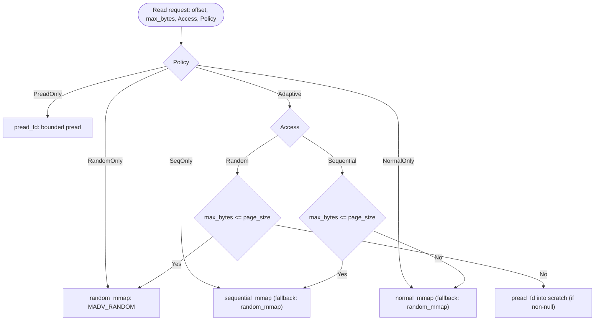

# Quadfecta Read-Path Specification

**Quadfecta** is a standalone, header-only Linux I/O routing mechanism (`src/vmemkv/core/quadfecta.hpp`) that exposes up to **four OS views over a single backing file** — three aliased `MAP_SHARED` virtual memory mappings (`MADV_RANDOM`, `MADV_SEQUENTIAL`, normal) plus a duplicated `pread()` file descriptor (`pread_fd`) — and selects the handle per read from `(Access, size <= page_size, Policy)`.

It requires only the C++20/23 standard library and Linux POSIX headers, allowing reuse in any larger-than-memory (LTM) storage engine or reader independent of VMemKV.

---

## 1. Overview & Motivation

In Linux, `madvise()` hints (`MADV_RANDOM`, `MADV_SEQUENTIAL`, `MADV_NORMAL`) are attributes of a **virtual memory area (VMA)**, not individual memory accesses or shared page-cache frames. A single-`mmap` design therefore faces a structural trade-off on mixed LTM workloads:

| Single-Handle Strategy | Small Random Read (`Get`, `<= page_size`) | Contiguous Scan (`Scan`) | Large Random Read (`Get`, `> page_size`) |
| --- | --- | --- | --- |
| `MADV_RANDOM` only | Optimal (zero-copy, no speculative I/O) | Loses readahead; pays synchronous fault latency | Multiple synchronous page faults across pages |
| `MADV_NORMAL` / `MADV_SEQUENTIAL` | Readahead amplifies SSD traffic & evicts hot pages | Good readahead | Readahead pulls unrequested trailing pages |
| `pread()` only | Syscall + user-space copy overhead on hot cache hits | Syscall + copy per record | Optimal bounded read when cache hit rate is low |

Quadfecta eliminates this trade-off by aliasing the same physical file across three independent VMAs alongside one `pread()` descriptor and routing each read deterministically according to access intent and record size.

---

## 2. Access Routing Specification

In `Policy::Adaptive` (default), `quadfecta::MappedReader` selects one of four read handles by **access pattern** (`Access::Random` vs `Access::Sequential`) and **size threshold** (`max_bytes <= page_size()` vs `> page_size()`):

| Access Pattern | Record Size | Selected Handle | Kernel / Syscall Behavior |
| --- | --- | --- | --- |
| `Access::Random` | `<= page_size()` | `random_mmap` (`MADV_RANDOM`) | Zero-copy read; kernel readahead disabled (`VM_RAND_READ`) |
| `Access::Sequential` | `<= page_size()` | `sequential_mmap` (`MADV_SEQUENTIAL`) | Zero-copy read; aggressive kernel readahead (`VM_SEQ_READ`) |
| `Access::Sequential` | `> page_size()` | `normal_mmap` (default advice) | Zero-copy read; standard adaptive kernel readahead |
| `Access::Random` | `> page_size()` | `pread_fd` (`::pread()`) | Single bounded `::pread()` into caller `scratch`; skips page faults |



### Policy Overrides & Best-Effort Fallbacks

`quadfecta::Policy` lets callers pin every read to a single mechanism (useful for controlled comparison benchmarks or constrained environments):

- `Policy::RandomOnly`: Always returns `random_mmap`.
- `Policy::SeqOnly`: Returns `sequential_mmap`, falling back to `random_mmap` if secondary setup failed.
- `Policy::NormalOnly`: Returns `normal_mmap`, falling back to `random_mmap` if secondary setup failed.
- `Policy::PreadOnly`: Always executes `::pread()` via `pread_fd` (using caller `scratch`, or a `thread_local` scratch vector if `scratch == nullptr`).
- Under `Policy::Adaptive`:
  - `Access::Sequential` selects `sequential_mmap` (`<= page_size()`) or `normal_mmap` (`> page_size()`), and falls back to `random_mmap` if the preferred secondary mapping is `nullptr`.
  - `Access::Random` with `max_bytes > page_size()` requires a non-null caller `scratch`; if `scratch == nullptr` or `pread_fd < 0`, `view_at_most()` returns `std::nullopt` so the caller can invoke its own fallback path.

---

## 3. Linux VM Mechanics & Page Cache Semantics

1. **Zero Physical Page-Cache Duplication (Multi-VMA Aliasing)**:
   All three mappings (`random_mmap`, `sequential_mmap`, `normal_mmap`) map the same underlying file descriptor with `PROT_READ, MAP_SHARED`. In Linux, `address_space` page-cache frames belong to the backing `inode`, not individual `vm_area_struct` entries. Aliasing three VMAs therefore increases virtual address reservation (`RLIMIT_AS` / `/proc/<pid>/maps` by 3 VMA slots), **not physical RAM residency**.
2. **Bounded `pread()` for Large Random Reads**:
   Random records exceeding one OS page (`page_size()`) rarely hit cached multi-page runs under LTM memory pressure. Using `::pread(pread_fd_, ..., len, offset)` avoids synchronous multi-page minor/major fault roundtrips across `VMA` boundaries and bounds SSD I/O to the caller-supplied upper limit (`std::min(max_bytes, limit - offset)`).
3. **Cache Warming (`prefetch`)**:
   `MappedReader::prefetch(offset, len)` rounds `offset` down to the OS page boundary (as required by Linux `madvise(2)`) and issues `::madvise(..., MADV_WILLNEED)` covering `[offset, offset + len)` clamped to `capacity()`. Because the page cache is shared, warming via `random_mmap_` primes reads across all mappings and `pread_fd`.
4. **Thread Safety**:
   `const` read methods (`view_at_most`, `read`, `mapping_for`, `prefetch`) take no locks and share no mutable member state. Threads sharing one `MappedReader` are race-free provided each thread supplies its own `scratch` buffer (except `Policy::PreadOnly` with `scratch == nullptr`, which uses an internal `thread_local` buffer).

---

## 4. Preconditions & Integration Contract

Any system adopting `quadfecta::MappedReader` must satisfy three external invariants over `[0, valid_end)`:

1. **Immutability Below `valid_end`**:
   Quadfecta provides no internal read-write synchronization (no locks, seqlocks, or version checks). Callers must guarantee that bytes in `[0, valid_end)` are immutable while reads may observe them — for example, by opening an immutable file (`open_readonly()`), swapping epochs/snapshots externally, or redirecting concurrent in-place updates out of `[0, valid_end)` as in VMemKV's `read_only_offset` boundary.
2. **Upper-Bound Size Hint (`max_bytes`)**:
   Because `::pread()` runs *before* reading the payload header, the caller supplies an upper-bound byte estimate `max_bytes` (e.g., an inline size hint embedded in an index pointer, or exact byte count).
   - If the true record length in the returned header exceeds `window->size()`, the caller must treat the read as truncated/incomplete (`std::nullopt`) and retry or widen via its fallback path.
   - `page_size()` comparison uses `max_bytes` directly, so accurate hints also prevent small records from needlessly crossing into the `> page_size()` `pread()` path.
3. **Returned `std::span<const std::byte>` Lifetime**:
   - **Zero-copy `mmap` paths**: The returned span points directly into the `MappedReader` VMA and remains valid as long as the `MappedReader` instance lives (and backing file offsets remain unpunched/valid).
   - **`pread()` paths**: The returned span points into `*scratch` (or internal `tl_pread_scratch` under `Policy::PreadOnly` with `nullptr`), and is invalidated by the caller's next mutation/reuse of that buffer.

---

## 5. Header-Only API & Caller Patterns

`src/vmemkv/core/quadfecta.hpp` defines namespace `quadfecta` with zero external repository dependencies:

| Symbol | Role |
| --- | --- |
| `quadfecta::Access` | `Random` (point lookup) / `Sequential` (contiguous scan) |
| `quadfecta::Policy` | `Adaptive` (default) or explicit `RandomOnly`, `SeqOnly`, `NormalOnly`, `PreadOnly` |
| `MappedReader::open_readonly(path)` | Opens a read-only file, maps `random_mmap`, attaches secondary handles best-effort |
| `MappedReader(primary_random_mmap, capacity)` | Adopts an existing primary `MADV_RANDOM` mapping (owned and unmapped on destruction) |
| `open_secondary_handles(fd)` | Best-effort maps `normal_mmap`, `sequential_mmap`, and `F_DUPFD_CLOEXEC` `pread_fd` |
| `read(offset, size, access, scratch, policy)` | Fixed-size read returning exact `size` bytes or `std::nullopt` |
| `view_at_most(offset, max_bytes, valid_end, access, scratch, policy)` | Variable-length read returning mmap tail up to `min(valid_end, capacity())` or bounded `pread()` |
| `prefetch(offset, len)` | Best-effort `MADV_WILLNEED` readahead trigger on `random_mmap` |

### Pattern A: Fixed-Size / Known-Length Reads (`read`)

Suitable when index metadata already stores the exact byte length of a chunk or record:

```cpp
auto reader = quadfecta::MappedReader::open_readonly(segment_path);
std::vector<std::byte> scratch;

if (auto view = reader.read(offset, exact_len, quadfecta::Access::Random, &scratch)) {
  consume(*view);
}
```

### Pattern B: Variable-Length Header-Prefixed Reads (`view_at_most`)

Suitable when the exact record length sits inside an in-file header and the index carries only a size hint (`max_bytes`) and dynamic monotonic watermark (`valid_end`):

```cpp
const auto window = reader.view_at_most(offset, size_hint, valid_end, access, &scratch);
if (!window.has_value() || window->size() < sizeof(Header)) {
  return std::nullopt;  // Missing path, pread failure, or outside [0, valid_end)
}
const auto *hdr = reinterpret_cast<const Header *>(window->data());
if (sizeof(Header) + hdr->payload_len > window->size()) {
  return std::nullopt;  // Size hint underestimated actual record; caller falls back
}
return parse_record(hdr);
```

### Integration in VMemKV

VMemKV embeds `quadfecta::MappedReader` as `T2Memory::reads` and calls `view_at_most()` from `try_read_immutable_record()` with `valid_end = read_only_offset` and `max_bytes = immutable_size_hint(payload_bits)`. Reads above `read_only_offset` or returning `std::nullopt` fall back cleanly to `T2FlatFile::at()` under the record seqlock. See [`low_level_design.md`](low_level_design.md) and [`terminology.md`](terminology.md) for VMemKV-specific invariants.
